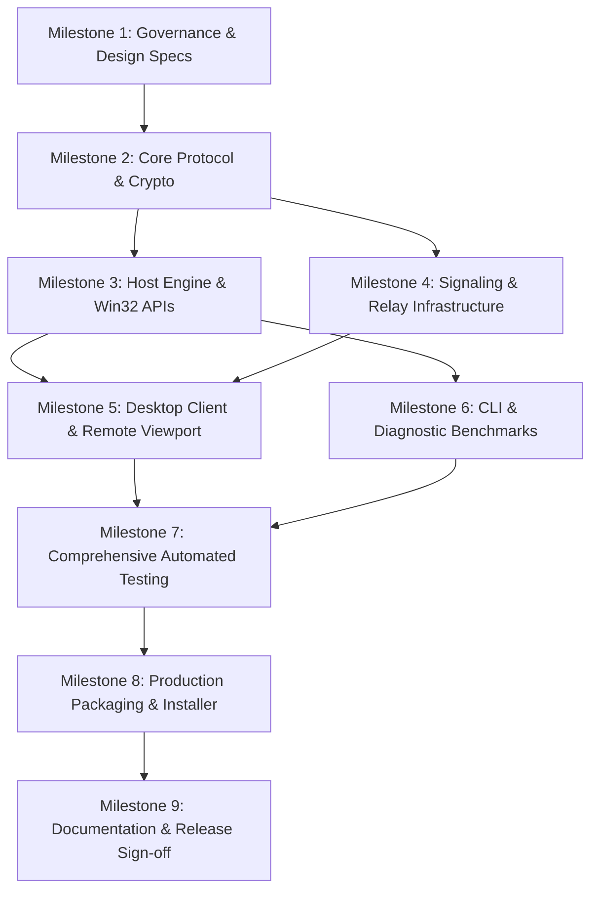

# AetherDesk - Implementation Roadmap

This roadmap tracks detailed work packages, technical deliverables, and verification checkpoints for the AetherDesk production release.

---

## Detailed Work Breakdown Structure (WBS)

### Phase 1: Foundations & Protocol Layer
- [x] Solution & multi-project setup (`Core`, `Host`, `Server`, `Client`, `Cli`, `Tests`).
- [x] Baseline compilation and automated test pipeline verification.
- [x] Governance and master plan documentation.
- [ ] Implement `AetherDesk.Core.Protocol`:
  - Binary framing header (`ADBP` magic, version, flags, opcode, payload size).
  - Strongly typed message envelopes for all remote desktop operations.
  - Efficient zero-allocation memory buffers using `ReadOnlyMemory<byte>` and `ArrayPool`.
- [ ] Implement `AetherDesk.Core.Security`:
  - ECDH key agreement with Curve25519 / NIST P-256 and HKDF derivation.
  - AES-256-GCM symmetric session encryptor/decryptor with sequence counter.
  - Secure random token generator and PBKDF2 password hasher.
- [ ] Implement `AetherDesk.Core.Identity`:
  - Hardware fingerprint generation (CPU, MAC, Machine GUID).
  - 9-digit user-friendly Device ID generator with checksum verification.
- [ ] Implement `AetherDesk.Core.Storage`:
  - SQLite WAL database repository for client settings, history, and address book.

### Phase 2: Host Engine & Native OS Integration
- [ ] Implement `AetherDesk.Host.Capture`:
  - Win32 GDI / DXGI Desktop frame grabber.
  - Frame tile divider (64x64 blocks).
  - xxHash64 delta comparison engine to isolate changed regions.
  - Adaptive tile compressor (LZ4 / Deflate).
- [ ] Implement `AetherDesk.Host.Input`:
  - Win32 `SendInput` mouse injector (normalized absolute coordinates 0..65535).
  - Win32 `SendInput` keyboard injector (scan codes, virtual keys, unicode chars).
- [ ] Implement `AetherDesk.Host.Monitors`:
  - Multi-display enumeration via `EnumDisplayMonitors`.
  - Resolution and virtual coordinate mapping.
- [ ] Implement `AetherDesk.Host.Clipboard`:
  - Win32 clipboard format listener (`AddClipboardFormatListener`).
  - Text and data change synchronization.
- [ ] Implement `AetherDesk.Host.Session`:
  - Host session coordinator managing connection states, permissions, attended approvals, and unattended passwords.

### Phase 3: Signaling & Relay Infrastructure
- [ ] Implement `AetherDesk.Server.Signaling`:
  - WebSocket and TCP signaling hub.
  - Device registry and live heartbeat presence monitor.
  - Peer rendezvous broker (session invites, accepts, candidate exchange).
- [ ] Implement `AetherDesk.Server.Relay`:
  - High-throughput encrypted packet forwarding engine.
  - Zero-knowledge data routing between firewalled peers.
  - Bandwidth rate limiting and session isolation.
- [ ] Implement `AetherDesk.Server.Api`:
  - REST endpoints for system health, active sessions, and diagnostics.

### Phase 4: Desktop Application & Remote Viewer
- [ ] Implement Modern Dark Fluent Theme & Styles:
  - Space navy background, electric cyan accents, emerald status indicators.
- [ ] Implement Main Dashboard View:
  - Local Device ID card with one-click copy.
  - Remote partner connection input box and Connect button.
  - Incoming connection authorization prompt with granular permission toggles.
  - Recent sessions and trusted devices list.
- [ ] Implement Remote Viewer Viewport:
  - Responsive screen display surface with hardware scaling.
  - Mouse and keyboard event capturer sending low-latency input packets.
  - Session toolbar (Full-screen, Ctrl+Alt+Del, Monitor Switcher, File Transfer, Chat, Disconnect).
  - Real-time diagnostic HUD (FPS, latency RTT ms, bandwidth KB/s, connection mode).
- [ ] Implement Dual-Pane File Transfer Manager:
  - Local file tree vs remote file tree.
  - Bidirectional file upload/download queue with progress indicator and SHA-256 verification.
- [ ] Implement In-Session Real-Time Chat:
  - Message exchange between technician and host user.
- [ ] Implement Settings View:
  - Unattended access configuration (password with strength meter).
  - Display quality options (Balanced, Low Latency, High Quality).
  - Custom signaling server configuration.

### Phase 5: Verification, Packaging & Release
- [ ] Comprehensive unit tests for protocol, crypto, and compression.
- [ ] Integration tests for signaling, presence, and relay routing.
- [ ] End-to-end simulated session test harness.
- [ ] Windows Installer script and release build automation.
- [ ] Complete technical documentation package (25 markdown documents).
- [ ] Release notes and validation sign-off report.
