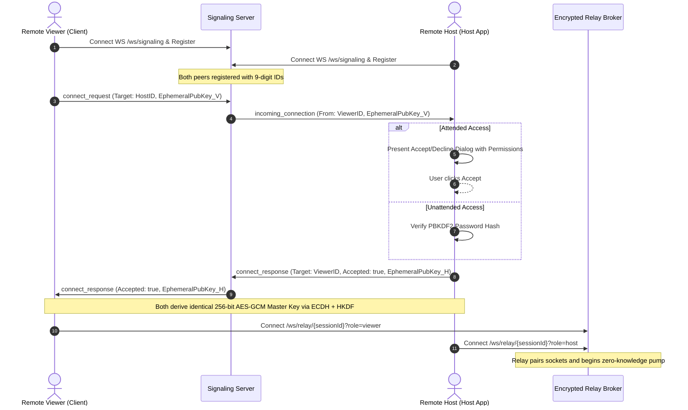
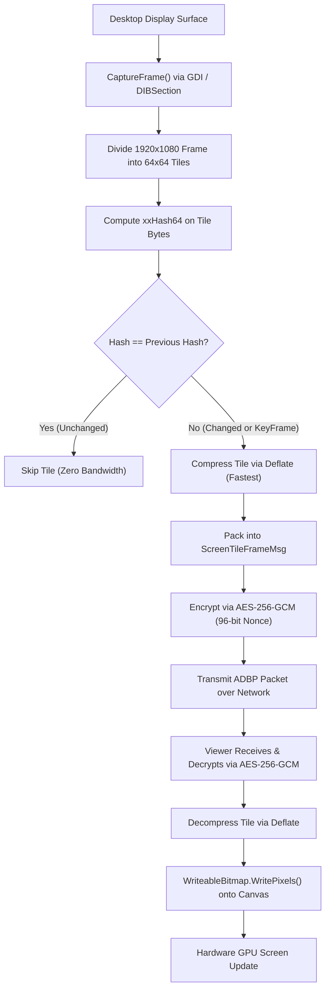
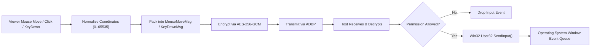

# AetherDesk - Architecture Diagrams & Flowcharts

## 1. Connection Establishment & Session Negotiation Sequence

---

## 2. Low-Latency Screen Capture & Streaming Pipeline

---

## 3. Remote Input Injection Flow

