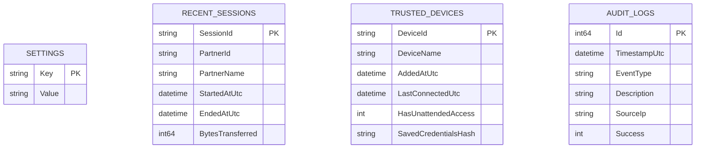

# AetherDesk - Database Architecture & Schema Specification

## 1. Engine & Configuration
AetherDesk utilizes an embedded SQLite engine managed through `Microsoft.Data.Sqlite`.
- **Location**: `%LOCALAPPDATA%\AetherDesk\aetherdesk.db`
- **Journal Mode**: `WAL` (Write-Ahead Logging) via `PRAGMA journal_mode = WAL;`
- **Synchronization**: `NORMAL` via `PRAGMA synchronous = NORMAL;`
- **Concurrency**: Multiple concurrent readers with single active serialized writer.

---

## 2. Entity Relationship Model



---

## 3. Schema DDL Definition

### 3.1 Settings Table
```sql
CREATE TABLE IF NOT EXISTS Settings (
    Key TEXT PRIMARY KEY,
    Value TEXT NOT NULL
);
```

### 3.2 Recent Sessions Table
```sql
CREATE TABLE IF NOT EXISTS RecentSessions (
    SessionId TEXT PRIMARY KEY,
    PartnerId TEXT NOT NULL,
    PartnerName TEXT NOT NULL,
    StartedAtUtc TEXT NOT NULL,
    EndedAtUtc TEXT,
    BytesTransferred INTEGER NOT NULL DEFAULT 0
);
CREATE INDEX IF NOT EXISTS IX_RecentSessions_StartedAt ON RecentSessions (StartedAtUtc DESC);
```

### 3.3 Trusted Devices Table
```sql
CREATE TABLE IF NOT EXISTS TrustedDevices (
    DeviceId TEXT PRIMARY KEY,
    DeviceName TEXT NOT NULL,
    AddedAtUtc TEXT NOT NULL,
    LastConnectedUtc TEXT NOT NULL,
    HasUnattendedAccess INTEGER NOT NULL DEFAULT 0,
    SavedCredentialsHash TEXT
);
```

### 3.4 Audit Logs Table
```sql
CREATE TABLE IF NOT EXISTS AuditLogs (
    Id INTEGER PRIMARY KEY AUTOINCREMENT,
    TimestampUtc TEXT NOT NULL,
    EventType TEXT NOT NULL,
    Description TEXT NOT NULL,
    SourceIp TEXT NOT NULL,
    Success INTEGER NOT NULL DEFAULT 1
);
CREATE INDEX IF NOT EXISTS IX_AuditLogs_Timestamp ON AuditLogs (TimestampUtc DESC);
```
