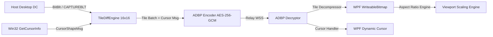

# AETHERDESK — DISPLAY & RENDERING ARCHITECTURE
**Document ID:** AD-ARCH-DISP-002  
**Target:** Screen Capture, Viewport Mathematics, Scaling Modes, and Cursor Synchronization  

---

## 1. Display Pipeline Architecture

---

## 2. Viewport Mathematics & Scaling Modes

Let $W_{\text{remote}}, H_{\text{remote}}$ be the remote desktop dimensions, and $W_{\text{avail}}, H_{\text{avail}}$ be the local viewer canvas bounds.

### 2.1 Fit to Window (Default)
$$\text{scale} = \min\left(\frac{W_{\text{avail}}}{W_{\text{remote}}}, \frac{H_{\text{avail}}}{H_{\text{remote}}}\right)$$
$$W_{\text{render}} = \lfloor W_{\text{remote}} \times \text{scale} \rfloor, \quad H_{\text{render}} = \lfloor H_{\text{remote}} \times \text{scale} \rfloor$$
- Scrollbars: Disabled.
- Letterbox offset: $X_{\text{offset}} = \frac{W_{\text{avail}} - W_{\text{render}}}{2}$, $Y_{\text{offset}} = \frac{H_{\text{avail}} - H_{\text{render}}}{2}$.

### 2.2 Fill Screen
$$\text{scale} = \max\left(\frac{W_{\text{avail}}}{W_{\text{remote}}}, \frac{H_{\text{avail}}}{H_{\text{remote}}}\right)$$
$$W_{\text{render}} = \lceil W_{\text{remote}} \times \text{scale} \rceil, \quad H_{\text{render}} = \lceil H_{\text{remote}} \times \text{scale} \rceil$$
- Scrollbars: Disabled. Viewport fills available area, center-cropping excess.

### 2.3 Original Size (1:1)
$$W_{\text{render}} = W_{\text{remote}}, \quad H_{\text{render}} = H_{\text{remote}}$$
- Scrollbars: Automatic. Unconstrained pixel-for-pixel rendering.

---

## 3. Inverse Coordinate Transformation

To ensure mouse clicks land on the exact remote pixel:
1. Capture local click position relative to the rendered `Image` element: $(X_{\text{local}}, Y_{\text{local}})$.
2. Clamp to rendered dimensions $[0, W_{\text{render}}]$ and $[0, H_{\text{render}}]$.
3. Map to remote desktop coordinate space:
   $$X_{\text{remote}} = \left(\frac{X_{\text{local}}}{W_{\text{render}}}\right) \times (W_{\text{remote}} - 1)$$
   $$Y_{\text{remote}} = \left(\frac{Y_{\text{local}}}{H_{\text{render}}}\right) \times (H_{\text{remote}} - 1)$$
4. Normalize to $0..65535$:
   $$\text{normX} = \text{round}\left(X_{\text{remote}} \times \frac{65535}{W_{\text{remote}} - 1}\right)$$
   $$\text{normY} = \text{round}\left(Y_{\text{remote}} \times \frac{65535}{H_{\text{remote}} - 1}\right)$$

---

## 4. Cursor Shape Tracking & Local Emulation

- **Host Side**: `HostCursorManager` polls `User32.GetCursorInfo` at ~30 Hz. Compares cursor handle with cached system cursors (`IDC_ARROW`, `IDC_IBEAM`, `IDC_HAND`, etc.). Emits `CursorShapeMsg` when changed.
- **Viewer Side**: Maps cursor type to WPF `Cursors.*` without latency or crosshair fallback.
