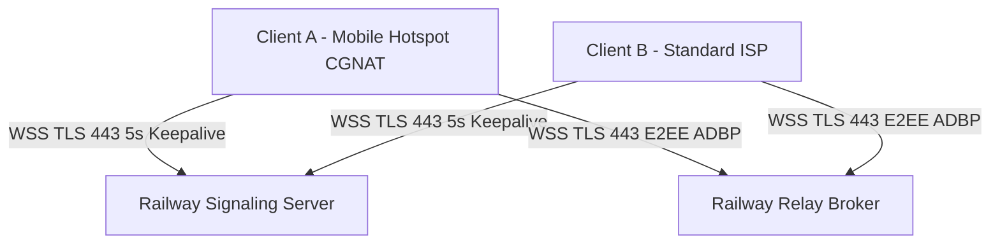

# AETHERDESK — NETWORKING & TRANSPORT ARCHITECTURE
**Document ID:** AD-ARCH-NET-002  
**Target:** Real-Time Signaling, NAT Traversal, CGNAT Resilience, and Relaying  

---

## 1. Network Topology Overview

AetherDesk utilizes a dual-path hybrid communication model:
1. **Public Signaling Fabric**: Hosted on Railway (`wss://aetherdesk-production.up.railway.app/ws/signaling`). Provides real-time device discovery, presence tracking, and ephemeral ECDH key exchange.
2. **Encrypted Media Relay**: Hosted on Railway (`/ws/relay/{sessionId}`). Provides end-to-end encrypted ADBP byte forwarding across symmetric NATs and mobile CGNATs.



---

## 2. Carrier-Grade NAT (CGNAT) Mitigation Strategy

Mobile carriers route hotspot traffic through carrier-level NAT gateways:
- **Port Mapping Expiration**: Carrier NAT state tables time out idle TCP sockets after 30 to 60 seconds.
- **5-Second Proactive Heartbeat**: `ClientNetworkManager` sends `{ type: "heartbeat", deviceId: ... }` every 5 seconds. This guarantees that cellular NAT mappings remain open indefinitely.
- **Supervisor Auto-Reconnect**: If a carrier radio transition drops the TCP connection, `RunSignalingSupervisorAsync` executes exponential backoff retries (1s, 2s, 4s, 8s) and immediately re-registers the Device ID.

---

## 3. Thread-Safe Socket Queuing (`System.Threading.Channels`)

.NET `ClientWebSocket` strictly forbids concurrent calls to `SendAsync`. Simultaneous calls throw `InvalidOperationException` and abort the underlying socket.

AetherDesk addresses this via a bounded `Channel<AdbpPacket>` with a dedicated background writer task:
```csharp
private readonly Channel<AdbpPacket> _outboundQueue = Channel.CreateBounded<AdbpPacket>(new BoundedChannelOptions(256)
{
    FullMode = BoundedChannelFullMode.Wait,
    SingleReader = true
});
```
- **Serialization Safety**: Only one thread ever invokes `SendAsync` on the WebSocket.
- **Backlog Management**: When network congestion occurs, screen tiles are dropped or throttled, while user inputs (mouse clicks, keystrokes, ping) are immediately dispatched.
