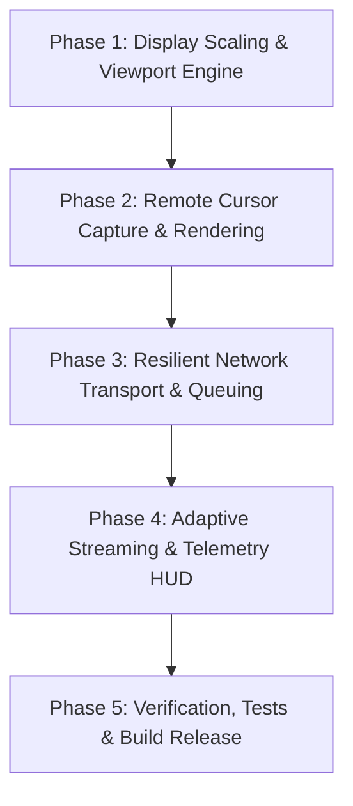

# AETHERDESK — MASTER REMEDIATION IMPLEMENTATION PLAN
**Document ID:** AD-PLAN-001  
**Target:** Display Scaling, Cursor Rendering, Mobile Hotspot Traversal & Adaptive Streaming  
**Classification:** Engineering Roadmap & Execution Plan  

---

## 1. Objectives

1. **Issue 1 (Display Scaling)**: Correct viewport layout, implement 4 distinct viewing modes (Fit to Window, Fill Screen, Original 1:1, Full-Screen F11), preserve aspect ratios without distortion, and implement precision inverse coordinate transformation for mouse input.
2. **Issue 2 (Cursor Rendering)**: Remove hardcoded crosshair (`+`), extract genuine remote cursor shape and visibility via Win32 `GetCursorInfo`, transmit over ADBP, and render matching WPF cursor shapes locally without drift.
3. **Issue 3 (Network Connectivity & Mobile Hotspot)**: Eliminate asymmetric failures over mobile hotspots by implementing signaling auto-reconnect with exponential backoff, frequent 5s keepalives, thread-safe outbound socket queues (`System.Threading.Channels`), packet prioritization, and adaptive FPS streaming.
4. **Diagnostics Panel**: Provide in-session real-time metrics (FPS, bandwidth, RTT latency, resolution, connection type) and one-click diagnostics export.

---

## 2. Implementation Phases

### Phase 1: Display Scaling & Viewport Engine
- **Files**: `src/AetherDesk.Client/Views/ViewerWindow.xaml`, `src/AetherDesk.Client/Views/ViewerWindow.xaml.cs`
- **Actions**:
  1. Remove hardcoded `Width` and `Height` assignments on `ImgViewport` in `InitBitmap`.
  2. Implement proper container sizing with letterbox/pillarbox calculation:
     $$\text{scale} = \min\left(\frac{W_{\text{avail}}}{W_{\text{remote}}}, \frac{H_{\text{avail}}}{H_{\text{remote}}}\right)$$
     $$W_{\text{rendered}} = W_{\text{remote}} \times \text{scale}, \quad H_{\text{rendered}} = H_{\text{remote}} \times \text{scale}$$
  3. Support all 4 viewing modes:
     - Fit to Window (Default)
     - Fill Screen
     - Original Size (1:1 with scrollbars)
     - Full-Screen (F11 borderless with auto-hiding toolbar)
  4. Implement exact inverse coordinate transformation for mouse events taking into account letterboxing offsets and scaling factor.

### Phase 2: Remote Cursor Capture & Dynamic Client Rendering
- **Files**:
  - `src/AetherDesk.Host/Native/User32.cs`
  - `src/AetherDesk.Host/Capture/HostCursorManager.cs` (New)
  - `src/AetherDesk.Host/Session/HostSessionCoordinator.cs`
  - `src/AetherDesk.Core/Protocol/Messages/ScreenMessages.cs`
  - `src/AetherDesk.Client/Services/ViewerSession.cs`
  - `src/AetherDesk.Client/Views/ViewerWindow.xaml` and `.cs`
- **Actions**:
  1. Add `CURSORINFO`, `GetCursorInfo`, `GetIconInfo`, `ICONINFO` in `User32.cs`.
  2. Implement `HostCursorManager` to poll active cursor at 30-60 Hz, detect standard system cursors (Arrow, IBeam, Hand, SizeAll, SizeNS, SizeWE, SizeNESW, SizeNWSE, Wait, AppStarting, No, Cross, Help) or extract RGBA bitmap data.
  3. Dispatch `AdbpOpCode.CursorShape` and `AdbpOpCode.CursorPosition` over ADBP.
  4. In `ViewerWindow.xaml`, remove `Cursor="Cross"`.
  5. In `ViewerWindow.xaml.cs`, dynamically map remote cursor shapes to WPF cursors (`Cursors.Arrow`, `Cursors.IBeam`, etc.).

### Phase 3: Resilient Network Transport & Thread-Safe Queuing
- **Files**:
  - `src/AetherDesk.Client/Services/ClientNetworkManager.cs`
  - `src/AetherDesk.Host/Session/HostSessionCoordinator.cs`
  - `src/AetherDesk.Client/Services/ViewerSession.cs`
- **Actions**:
  1. Add exponential backoff auto-reconnection loop in `ClientNetworkManager.cs` (re-registering device ID on reconnection).
  2. Reduce signaling heartbeat to 5 seconds.
  3. Implement thread-safe `Channel<AdbpPacket>` outbound sender workers in `HostSessionCoordinator` and `ViewerSession` to eliminate concurrent `WebSocket.SendAsync` exceptions.
  4. Implement packet prioritization: mouse/keyboard input and ping packets take precedence over screen frames.

### Phase 4: Adaptive Streaming & Telemetry HUD
- **Files**:
  - `src/AetherDesk.Host/Session/HostSessionCoordinator.cs`
  - `src/AetherDesk.Client/Services/ViewerSession.cs`
  - `src/AetherDesk.Client/Views/ViewerWindow.xaml` and `.cs`
- **Actions**:
  1. Implement Ping/Pong RTT calculation.
  2. Dynamically throttle FPS (60 -> 30 -> 15 FPS) when RTT or network backlog rises.
  3. Display RTT, FPS, Bandwidth, and connection type in the top toolbar.
  4. Provide in-depth Diagnostics Flyout with copyable report.

### Phase 5: Verification, Automated Tests & Packaging
- **Files**:
  - `tests/AetherDesk.E2E.Tests/FullSessionE2ETests.cs`
  - `tests/AetherDesk.Core.Tests/ProtocolTests.cs`
- **Actions**:
  1. Add automated tests for coordinate transformation math and cursor shape serialization.
  2. Run `dotnet test` across the full test suite.
  3. Rebuild Release binaries and package zip distribution.
  4. Generate all architecture and test plan documentation.
