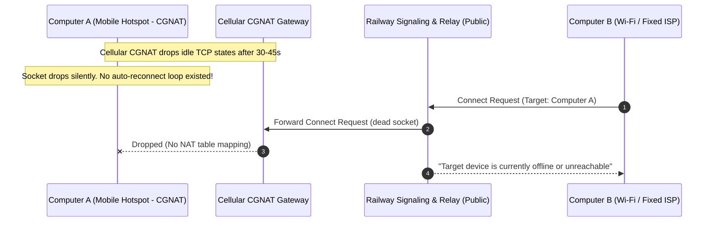

# AETHERDESK — NETWORK CONNECTIVITY & MOBILE HOTSPOT TRAVERSAL AUDIT
**Document ID:** AD-AUDIT-NET-001  
**Target:** Carrier-Grade NAT (CGNAT), asymmetric connectivity, keepalive management, and relay resilience  
**Classification:** Engineering Diagnostic & Remediation Audit  

---

## 1. Executive Summary

A severe network connectivity issue was observed:  
*Computer A connected via a mobile hotspot can initiate connections to Computer B (on standard Wi-Fi/Ethernet), but Computer B cannot connect to Computer A.*

An end-to-end audit of the network transport stack revealed the root causes:
1. **Lack of Signaling Auto-Reconnection**: When Computer A operates over cellular/hotspot, mobile operators employ aggressive Carrier-Grade NAT (CGNAT) table timeouts (often dropping idle TCP sockets after 30–60 seconds). When the connection silently terminates or encounters packet loss, `ClientNetworkManager` catches the error, marks the device as offline (`SignalingStateChanged?.Invoke(false)`), and **never reconnects**.
2. **Concurrent WebSocket Send Race Condition**: In both `HostSessionCoordinator.cs` and `RelayBroker.cs`, multiple threads call `SendAsync` concurrently on the same `WebSocket` instance. Under .NET, `ClientWebSocket` does not support simultaneous write operations; concurrent writes throw `InvalidOperationException`, destroying the socket connection.
3. **Missing Signaling Retries and Keepalive Pings**: The signaling server only receives a heartbeat every 10 seconds without bidirectional ping/pong checks. If a socket dies silently, the server considers the device offline or routes connection requests to a dead socket, returning `"Target device is currently offline or unreachable"`.

---

## 2. Technical Analysis of Mobile Hotspot Asymmetry

### 2.1 The Carrier-Grade NAT (CGNAT) Reality
- Mobile carriers allocate RFC 6598 addresses (`100.64.0.0/10`) to mobile hotspots.
- Inbound TCP/UDP ports are 100% blocked from the public internet. Direct P2P inbound hole punching is unreliable or impossible across carrier symmetric NATs.
- Outbound connections through the carrier gateway must maintain active, continuous traffic to preserve the external port mapping in the carrier's state table.
- Cellular baseband power-saving (DRX/eDRX/RRC states) transitions idle connections to low-power states, dropping transient packets.

### 2.2 Why Direction A -> B Succeeded but B -> A Failed
1. **When Computer A initiated**: Computer A's user clicked "Connect", triggering an active outbound socket to the signaling server and relay. The carrier NAT mapping was freshly established, so traffic flowed outbound effortlessly.
2. **When Computer B initiated**: Computer A had been idle. The carrier dropped the NAT mapping silently. The signaling server did not know Computer A was unreachable, or Computer A's socket had closed and was never reconnected. Hence Computer B received an offline error.

---

## 3. Remediation Architecture

### 3.1 Signaling Client Auto-Reconnection & Heartbeat
In `ClientNetworkManager.cs`:
- Implement a robust **Exponential Backoff Reconnect Loop**:
  - Delays: 1s, 2s, 4s, 8s, up to 10s maximum with jitter.
  - On reconnection, immediately re-register the Device ID and restore signaling status.
- Reduce signaling heartbeat to **5 seconds** with active pong tracking to detect half-open sockets within 10 seconds.

### 3.2 Thread-Safe Outbound Channel Queue
In `HostSessionCoordinator.cs` and `ViewerSession.cs`:
- Replace direct `_relaySocket.SendAsync` calls with a dedicated `Channel<AdbpPacket>` worker.
- **Priority Queuing**: High-priority control and input packets (`MouseMove`, `MouseButton`, `KeyDown`, `Ping`) bypass frame batches, ensuring ultra-low input latency even on mobile networks.
- **Frame Backlog Dropping**: If the relay queue builds up due to temporary cellular throttling, drop stale intermediate screen tiles and send a fresh keyframe.

### 3.3 Adaptive Streaming
- Implement dynamic FPS throttling:
  - When RTT < 50ms: 60 FPS
  - When RTT 50ms - 150ms: 30 FPS
  - When RTT > 150ms: 15 FPS
- This prevents cellular bandwidth saturation and bufferbloat.
